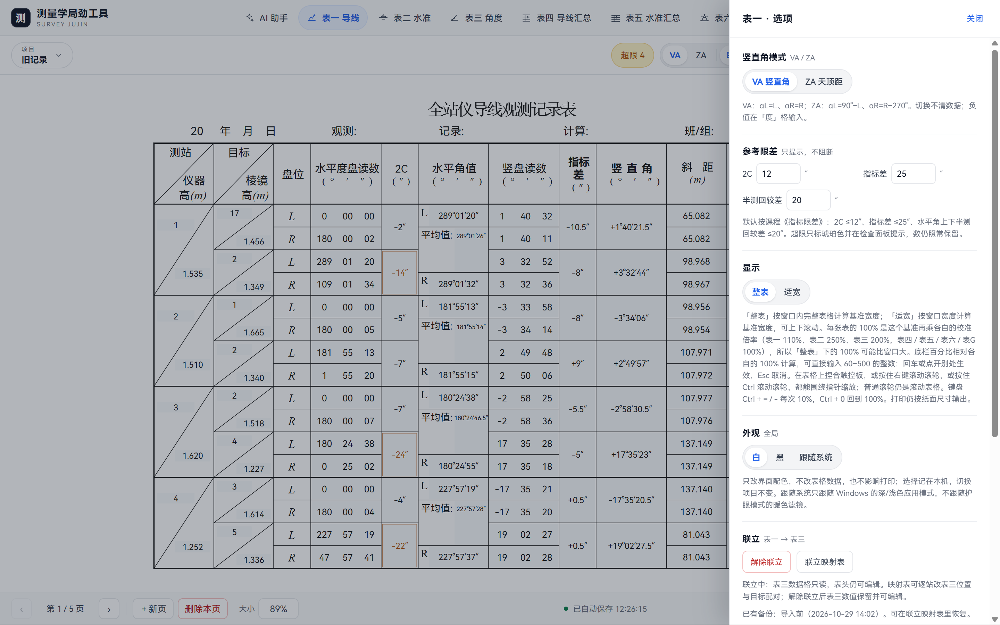
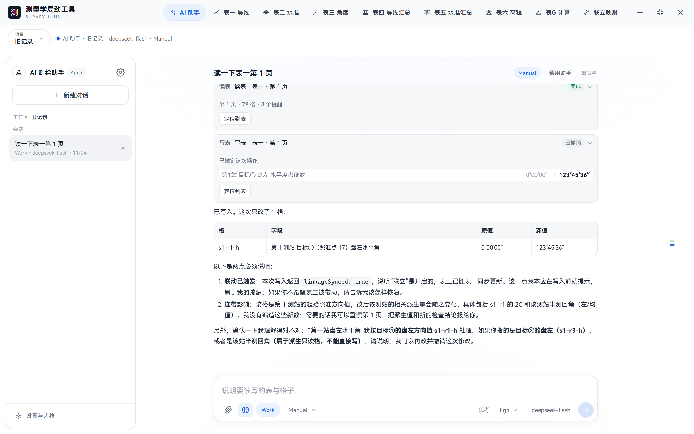
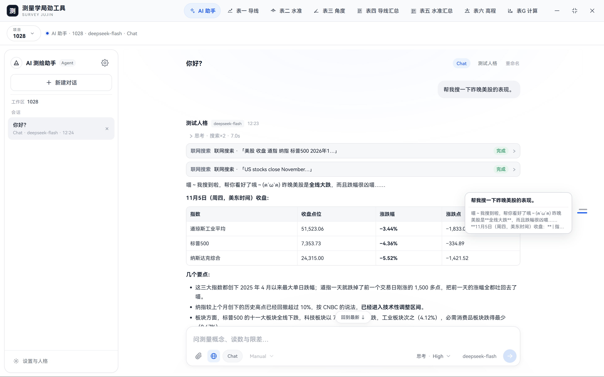
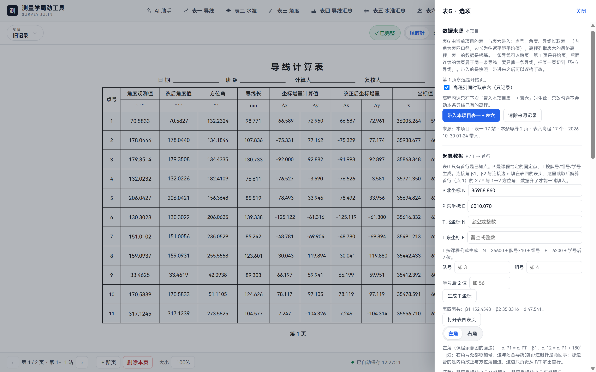

# 测量学局劲工具（Survey Jujin）· 测量学实习记录与平差 · Windows 桌面

测量学局劲工具（Survey Jujin）是面向土木类学生的测量学实习记录与平差工具。七张表联动：表一→表三可联立（默认关闭）；表四、表六由表一推导，表五由表二推导，表G 由表一与表六带入。软件以 Windows 桌面为主（Tauri v2 + WebView2），面向高校测量学课程；项目数据保存在本机。原创代码采用木兰宽松许可证第 2 版（MulanPSL-2.0）。

网页轻量版（纯静态、无需安装）：[survey-jujin-taibai-lite](https://github.com/JNGKZbird/survey-jujin-taibai-lite)

## 速览

- **给谁、在哪用**：土木类学生的测量学实习、课堂练习与课程设计；Windows 桌面（Tauri v2 + WebView2），另有 `web/index.html` 浏览器预览。
- **七张表**：表一、表二、表三是记录表；表四、表五、表六是汇总与平差；表G 是导线计算表。
- **两张源表**：日常录入集中在表一、表二；表四与表六由表一推导，表五由表二推导，表G 由表一与表六带入；表三可手填，也可与表一联立。
- **数据**：项目数据保存在本机，不上传；项目库采用原子写、备份与回读校验。
- **检查**：课程限差是软提示，可在界面里改，不阻断录入；误差色分白、绿、黄、红四档。
- **AI 助手（可选）**：Work 模式能读、写表一/表二并追加空白页，带逐格 diff、审批与撤销；也能识图填表、联网搜索、自定义人格。不配置也能用全部表格功能。
- **许可**：原创代码采用木兰宽松许可证第 2 版（MulanPSL-2.0）。

## 界面

下面是表一的实际界面，右侧是选项面板。



表一：限差在「选项」里改；只提示，不阻断录入。

**演示图中的数据经过修改，仅用于展示界面，不代表真实测量数据，也不构成测量成果。**

## 能做什么

**记录。** 表一录全站仪导线观测，4 站/页；表二录水准观测，8 站/页；表三录水平角与距离，6 站/页。三张记录表都可多页，上限 100 页。表一→表三可联立（默认关闭）；开启后表三只读，按全局站号取表一的水平度盘读数与斜距，竖盘读数不进表三。

**推导。** 表四导线测量原始数据汇总由表一推导，表五支水准测量原始数据汇总由表二推导，表六三角高程测量平差表由表一推导，表G 导线计算表由表一与表六联合带入。表四、表五、表六的正文不落盘，打开时按来源表现算；表G 的行数据会落盘，带入后还可以逐格改。

**检查。** 课程限差的默认值是 2C ≤ 12″、指标差 ≤ 25″、水平角上/下半测回较差 ≤ 20″；表六对向较差有 60√D、40√D、0.4×S 三档，闭合差按 40√ΣD；表G 的方位角闭合差按 fβ = 40″√n，导线全长相对闭合差按 K ≤ 1/4000。课程限差是默认值，可在界面里修改，不声称唯一口径。

**误差色。** ≤1× 保持默认纸色（图例称白色，不着色）；1–2× 绿、2–3× 黄、>3× 红，绿、黄、红整格铺底；边界值归下一档；默认关闭，顶栏可开。表五与表G 不上色，表G 只在摘要卡比较 fβ 与 K。

**打印。** 每张表按自己的 A4 版式排版（横向或纵向），屏幕缩放不影响打印尺寸；打印跟随误差色开关：关掉时白纸黑字，开着时整格底色与彩字一起印；深色主题不影响打印。

## AI 助手

AI 助手是软件的第二入口：它和七张表共用同一个项目，能直接读、写表一、表二，也能追加空白页；不配置模型也能用全部表格功能。

一个典型用法：把表一记录照片发给它，说「按照片填表一」。它会判断表别、识别读数、读取当前页，再给出逐格改动；Manual 模式下等你确认，Auto 模式在含图片的轮次也必须确认；写错了可以整批撤销。它不能删页，也不能写表三、表四、表五、表六、表G、设置或文件系统。

读表会带回限差提示；写表先预览，再校验页面指纹，任一格与预览时不一致就整批不写；撤销记录随会话保存。Chat 模式不会假装读过表，硬调表格工具也会被拦下。

- **Chat / Work 双模式**：Work 有读表、写表、加页三个工具，按 Only Read / Manual / Auto 执行；Chat 没有表格工具，只聊天、收图与联网搜索。默认 Work，模式会记住。
- **识图填表**：支持 1–4 张 PNG/JPEG/WebP，回形针、Ctrl+V 或拖放；图片在本地压缩、清除 EXIF；写表前先读，写后有差异预览与撤销。
- **联网搜索**：只走 DeepSeek 官方端点；每轮最多 2 次、每条回答最多 6 次；只保存标题、链接、站点与日期，不抓取网页正文。
- **自定义人格**：内置「通用助手」，可自建。提示词不设上限；超过 2000 字仅软提示（省词元），超过一万词元可能稀释注意力，更适合 Chat 模式；会话保存人格快照。
- **对话树**：重新生成、编辑后重发、分支切换；公式用 KaTeX 0.19.0 本地渲染。



Work 模式：读表、写表、撤销与联动提示都在对话里完成。



Chat 模式：联网搜索会给出搜索卡与来源卡，回答里的表格照常渲染。

**对话与行情均为演示数据。**

## 支持范围

七张表的分工、每页容量和数据来源如下。表一、表二、表三可多页，表四固定一页，表五、表六、表G 可多页；多页表上限 100 页。

| 表 | 内容 | 每页容量 | 数据来源 |
|---|---|---|---|
| 表一 | 全站仪导线观测记录表 | 4 站/页 | 手工录入；AI 助手可写 |
| 表二 | 三、四等水准测量记录、计算表（双面尺法） | 8 站/页 | 手工录入；AI 助手可写 |
| 表三 | 角度距离观测记录手簿 | 6 站/页 | 手工录入；或联立时取表一 |
| 表四 | 导线测量原始数据汇总 | 1 页 | 表一（强制映射） |
| 表五 | 支水准测量原始数据汇总 | 8 人/页，每人 4 段 | 表二（强制映射） |
| 表六 | 三角高程测量平差表 | 17 边/页 | 表一（强制映射） |
| 表G | 导线计算表 | 11 行/页 | 表一 + 表六（联合带入） |

表四、表五、表六的正文不落盘，打开时按来源表现算；表G 的行数据会落盘，可再改。表一→表三的联立默认关闭；开启后表三只读，竖盘读数不进表三。各表按 A4 版式打印；表G 的高程列只记录，不参与闭合与坐标推算。

## 与 Excel 模板对比

Excel 模板胜在自由、通用；本工具把七表关系和课程口径先做进来，适合不想自己维护公式的场景。

| 维度 | 本工具 | Excel 模板 |
|---|---|---|
| 自动推导 | 表四、表六←表一，表五←表二，表G←表一+表六 | 自己写公式、引用与校验 |
| 课程限差 | 内置默认值，软提示 + 误差色 | 自己设条件格式 |
| 数据存储 | 本机项目库，原子写 + 备份 | 文件保存，手工副本 |
| 打印 | 各表 A4 版式已排好 | 自己调页面与列宽 |
| 许可 | MulanPSL-2.0 | 取决于 Office 与模板授权 |

## 快速开始

便携版（需 WebView2）：[下载](https://github.com/JNGKZbird/survey-jujin-taibai/releases/download/v0.1.0/survey-jujin_0.1.0_x64-portable.exe)。安装包需从源码构建（pnpm build）；前置：Node.js 与 pnpm（或 npm）、Rust，以及 Tauri 2 的 Windows 构建依赖（WebView2、MSVC 构建工具）。

```bash
pnpm install
pnpm dev      # 启动桌面应用
pnpm build    # 构建
pnpm test     # Node 测试
```

只想看界面：用浏览器打开 `web/index.html`；这是开发预览，AI 发送禁用，数据走浏览器 localStorage，不写本机项目库。

### 给开发者

2026-11-06 实测：569 项 Node 测试（28 个测试文件）、46 项 Rust 测试。Rust 测试在 `src-tauri` 下运行：`cargo test --bin survey-jujin`。实现细节见 `docs/`。

## 使用流程

1. 新建项目；项目就是 AI 助手侧的工作区。
2. 在表一、表二录基础数据；表三可手填，也可在「选项」里开启表一→表三联立。
3. 打开表四、表五、表六、表G 看推导结果；表G 先从表一 + 表六带入，再按需改起算数据。
4. 检查限差与误差色；需要时在「选项」里改阈值。
5. 打印或导出；导出可分单表、当前项目七表、全部项目。

表G 的起算数据可以手填 P 点北/东坐标与首行方位角；课程给了队号、组号、学号后两位时，也可按 `N = 35600 + 队号×10 + 组号`、`E = 6200 + 学号后2位` 生成 T 点坐标，没有编号时手填即可。



表G：点号、角度、边长来自表一，高程来自表六；起算数据可手填，也可由 P/T 坐标解算首行方位角。

**演示图中的数据经过修改，仅用于展示界面，不代表真实测量数据，也不构成测量成果。**

## 常见问题

### 只填表一、表二够吗？

够。表四、表五、表六、表G 不用单独填；表三可开联立自动取表一，也可手填。

### 课程作业能用吗？不是野外实习也行吗？

可以。七张表按高校测量学课程设计，课堂练习、课程设计、实习记录都能用；限差可在「选项」里改。

### 限差用哪个口径？超了会拦住吗？

默认 2C ≤ 12″、指标差 ≤ 25″、水平角上/下半测回较差 ≤ 20″；表六与表G 另有公式。限差只是软提示，可在界面改，不阻断录入。

### 数据存在哪？会上传吗？

项目库在 `%APPDATA%\com.jngkzbird.survey-jujin\store.json`；项目数据不上传，AI 对话、图片与搜索词会发往你配置的模型服务。

### 能只导出一张表吗？导入会覆盖其他表吗？

可以。导出分单表、当前项目七表、全部项目；单表导入只替换目标表与该表设置，其余六表、联立映射、项目名不变。联立开启时，表一与表三拒绝单表导入。

### 能打印吗？浏览器预览和桌面版有什么区别？

可以。各表按 A4 版式打印，屏幕缩放不影响尺寸。网页轻量版不含 AI、数据走 localStorage；桌面版才有本机项目库、备份与完整 AI。

### 没有队号、组号、学号，能用表G 吗？旧「正式版」是什么关系？

可以。编号只用于生成 T 坐标；没有编号时，手填 P 点北/东坐标与首行方位角即可。旧「正式版」是三表离线网页工具，本仓库是七表桌面工具，可并行使用。

### 为什么叫「局劲」？许可是什么？

「局劲」是陕北话「厉害」。原创代码与文档采用 MulanPSL-2.0；字体与 KaTeX 按各自许可。

## 数据与隐私

项目数据保存在本机，不上传；项目库采用原子写、备份与回读校验。具体位置是 `%APPDATA%\com.jngkzbird.survey-jujin\store.json`。写入采用 380 ms 防抖 + 原子写：临时文件、写盘、同步、重命名、回读比对；保留最近 20 份备份，连续 14 天每天首份，破坏性操作强制备份，损坏文件隔离为 `store.corrupt-时间戳.json`。

导出分三档：单表、当前项目七表、全部项目。导入按文件类型自动识别；单表导入只替换目标表页数据与该表设置，其余六表、联立映射、项目名、显示大小/缩放不变。导入是替换，不是合并或追加；联立开启时，表一与表三拒绝单表导入。

AI 数据流单独说明：支持 OpenAI 兼容端点，DeepSeek 预置；对话内容、图片与联网搜索词会发往你配置的模型服务；对话库 `agent.json` 未加密，附件在 `attachments` 未加密；API Key 存 Windows 凭据管理器。项目库不参与 AI 上传。浏览器预览使用 localStorage，没有原生文件与备份。

## 已知限制

- Release 提供 Windows 便携版，安装包需从源码构建；当前以 Windows 桌面为主，其他平台未验证。
- 课程限差是默认值，不同课程的口径请在「选项」里改，不声称唯一口径。
- AI 表格工具只写表一与表二，不能删页，不能写表三、表四、表五、表六、表G、设置或文件系统。
- 联网搜索只支持 DeepSeek 官方端点；不抓取网页正文；每轮最多 2 次、每条回答最多 6 次。
- 表五与表G 不上误差色；表G 只在摘要卡比较 fβ 与 K。
- 浏览器预览禁用 AI 发送；应用内截屏未实装。

## 许可与致谢

原创代码与文档采用木兰宽松许可证第 2 版（MulanPSL-2.0）。HarmonyOS Sans SC 按 HarmonyOS Sans Fonts License Agreement 随包分发，文件未修改；KaTeX 0.19.0 按其 MIT 许可。详见 `THIRD_PARTY_NOTICES.md`。

**特别致谢**：程序图标使用 Nuclear_Creeper（GitHub `NCreeper233`）的终末地风格 LOGO 生成器 `endfield-logo-maker`（MIT）制作，中文字体切换为 HarmonyOS Sans SC。

技术来源：平台与技术积累来自[捣蛋鬼桌宠](https://github.com/JNGKZbird/lemuel-scamp)；对话树行为源自鸿蒙端[予愿安洁莉娜桌宠](https://github.com/JNGKZbird/Arknights-Angelina-Pet-YuYuan-HarmonyOS-NEXT)。

彩蛋：如果你也在做《明日方舟》角色的人格蒸馏，可以看看[我们的公开预览库](https://github.com/JNGKZbird/Arknights-Persona-Distill)。
